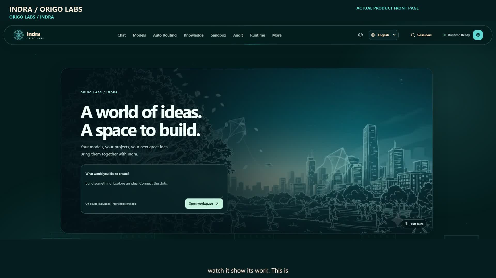

# Indra · Origo Labs

**An agent workstation that turns a project goal into inspectable work: files, tests, approval decisions and a verifiable handoff.**

Built on an existing local-first SIH agent foundation. This submission focuses on the desktop workbench, scoped project/knowledge workflow, model routing, verifiable goal completion and phone control developed and refined during the hackathon. [What is new, what is inherited](HACKATHON.md).

<strong>Give it a project. Set the goal. Inspect the work.</strong>

[Download Windows release candidate](https://github.com/Artyfowl1710/indra_Origo-Labs/releases/tag/v1.8.0-rc.1) · [User handbook](docs/handbook/index.md) · [Documentation website](https://Artyfowl1710.github.io/indra_Origo-Labs/) · [Evidence gallery](docs/handbook/evidence.md) · [Security](SECURITY.md)

Release links and the website become available after the maintainer publishes this prepared package. This is a **Windows x64 release candidate**, with independent testing on another PC still required.

## Watch the work, then inspect it

**One three-minute film for the submission and X.** Actual desktop, Telegram and Docker recordings, with a separate synthetic English narrator, original electronic score and captions. It opens on the actual animated Indra front page. Meta Muse Spark Open through Baseten investigates a fictional checkout project, fixes boundary/rounding bugs, adds regression tests, produces deliverables and records activity. The phone task is separate; its generated-program execution was not validated. The recorded Docker terminal mode mounts the selected project. No slide scenes, held screenshot scenes or simulated model answers. [Earlier 75-second teaser](https://github.com/Artyfowl1710/indra_Origo-Labs/releases/download/v1.8.0-rc.1/Indra-X-Launch-Trailer-75s.mp4).

| Workflow | Inspect in this repository |
| --- | --- |
| Give the agent a scoped folder and a measurable goal | [Projects and goals](docs/handbook/projects.md) |
| Retrieve document evidence before editing | [Knowledge and retrieval](docs/handbook/knowledge.md) |
| Choose API/local models and modality roles | [Providers and routing](docs/handbook/providers.md) |
| Review generated documents and test evidence | [Recorded outputs](examples/recorded-run/README.md) |
| Check which model did what | [Audit and provenance](docs/handbook/audit.md) |
| Continue through your own phone account | [Telegram and WhatsApp](docs/handbook/phone.md) |
| Use voice and light, teal or ember appearance | [Voice and appearance](docs/handbook/voice.md) |

## Install and try it

Windows x64 is required. Offline knowledge also needs the [Microsoft Visual C++ v14 x64 runtime](https://aka.ms/vc14/vc_redist.x64.exe) if your PC does not already have it; this prerequisite is documented in the [installation guide](docs/handbook/installation.md) and the release's `INSTALL-FIRST.txt`.

1. Open the release above. Download `Indra-Setup-1.8.0-rc.1.exe` and `SHA256SUMS.txt`.
2. Compare the SHA-256 hash before running it. The candidate installer is unsigned; inspect its source and publisher before deciding whether to run it. No antivirus exclusions are needed or supplied.
3. Install for your Windows account and open **Indra**. The installer bundles Python, Node and the desktop runtime; no separate browser or developer server is required.
4. In **Keys**, add your own provider credential. In **Models**, choose your provider and model. For the recorded hackathon workflow, select Baseten and `meta-models/muse-spark-open-1026`.
5. In **Chat → Projects**, select a copy of [the demo project](examples/atlas-checkout). Follow [the judge walkthrough](docs/handbook/judges.md).

The desktop and knowledge index run locally. API models and online connectors require internet access. Offline inference requires a separately installed local model server and downloaded weights; they are not bundled. No credentials or personal accounts are included.

## Source layout

| Folder | Contents |
| --- | --- |
| `origo-desktop/` | Native desktop shell, folder picker, lifecycle and private phone setup |
| `origo_runtime/` | Local inference routing, embeddings and runtime services |
| `indra/SIH-26/hermes-agent/` | Imported agent foundation and current workbench implementation; internal compatibility names retained |
| `tests/` | Product regression tests; foundation tests also remain under the imported source |
| `docs/handbook/` | Current user/developer handbook and Pages content |
| `docs/media/` | Curated screenshots and short real-footage clips |
| `examples/atlas-checkout/` | Intentionally buggy fictional starting project |
| `examples/recorded-run/` | Separate completed run and its actual generated outputs |
| `provenance/` | Import provenance, dependency record and release checks |

Private `data/`, chat databases, generated runtime outputs, model weights, caches, node_modules and binaries are excluded from Git. Only the reviewed fictional outputs under `examples/recorded-run/outputs/` are deliberately published. Your files do not become public just because Indra generated them.

## Develop, verify and release

See [development](docs/handbook/development.md), [testing](docs/handbook/testing.md), [architecture](docs/handbook/architecture.md), [release process](docs/handbook/release.md) and [known limits](docs/handbook/limitations.md). Test reports state their scope; a passing focused suite is not a claim that every optional connector has been tested.

## Lineage and licensing

Indra is a product by **Origo Labs**. The earlier [Indra_lok](https://github.com/Artyfowl1710/Indra_lok) project and the MIT-licensed Hermes agent foundation from Nous Research are part of its lineage. Existing orchestration, connector and tool capabilities are not claimed as wholly new. Original notices and internal identifiers are preserved where required for legal accuracy and compatibility. See [NOTICE](NOTICE.md), [LICENSE](LICENSE) and [the contribution boundary](HACKATHON.md).
