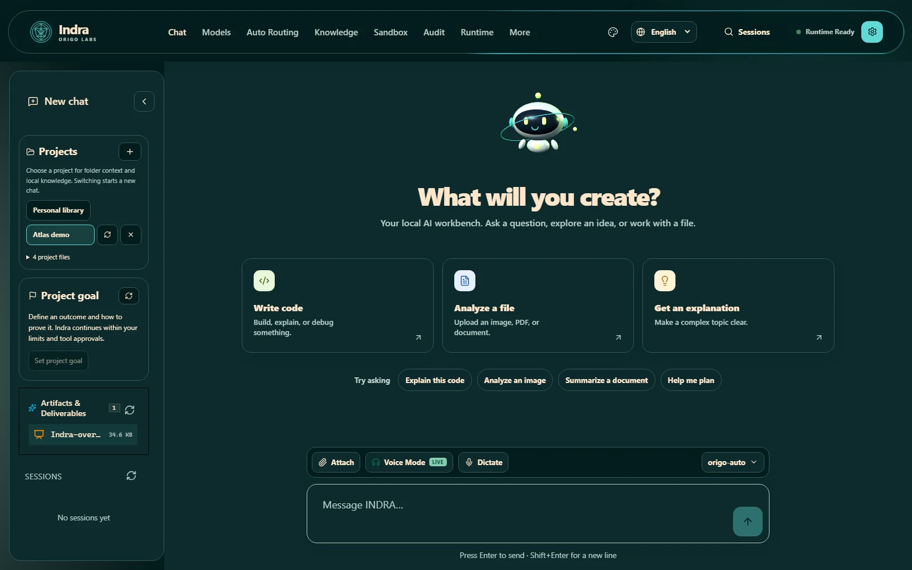
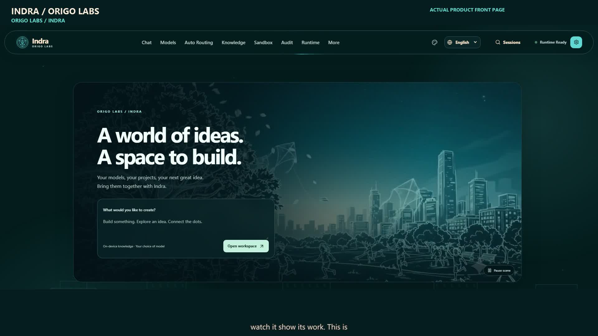

# Indra · Origo Labs

Indra is an open-source AI workstation for Windows. Choose a model, give it access to a project folder, and inspect its proposed actions, changed files, test results and audit records.

The desktop and knowledge index run locally. You can connect a hosted model provider or a compatible local inference server. The Indra integration is MIT-licensed. Imported components retain their original licenses and attribution.

[Download for Windows](https://github.com/Artyfowl1710/indra_Origo-Labs/releases/tag/v1.8.0-rc.1) · [Handbook](https://Artyfowl1710.github.io/indra_Origo-Labs/) · [Contribute](CONTRIBUTING.md) · [Security](SECURITY.md) · [License](LICENSE)

Projects view captured from an isolated workbench with fictional demo data. See the [gallery](docs/handbook/evidence.md) for the scope of each recording and screenshot.

## Try it

The current release is **1.8.0-rc.1 for Windows x64**. Validation on a separate Windows PC is still pending. Offline knowledge retrieval requires the [Microsoft Visual C++ v14 x64 runtime](https://aka.ms/vc14/vc_redist.x64.exe).

1. Download `Indra-Setup-1.8.0-rc.1.exe` and `SHA256SUMS.txt` from the release above. Verify the hash before running the installer. The candidate installer is unsigned.
2. Install for your Windows account and open Indra. Python, Node and the desktop runtime are bundled.
3. In **Keys** and **Models**, configure your provider and choose a model. For local inference, start a compatible server with separately downloaded weights and configure its endpoint. See [providers](docs/handbook/providers.md).
4. Copy [the checkout example](examples/atlas-checkout) into a writable folder. Select it in **Chat → Projects**, then follow the [guided example](docs/handbook/judges.md).

Hosted inference and online connectors require internet access. Provider credentials, messaging accounts and large local model weights are supplied by the user. See [installation](docs/handbook/installation.md) for prerequisites and profile locations.

## Workflows

| Task | Guide |
| --- | --- |
| Grant a project folder and review actions | [Projects and approvals](docs/handbook/projects.md) |
| Search local documents and inspect retrieved sources | [Knowledge and retrieval](docs/handbook/knowledge.md) |
| Connect hosted models, Ollama, llama.cpp or vLLM | [Providers](docs/handbook/providers.md) |
| Inspect model attribution and signed event records | [Audit](docs/handbook/audit.md) |
| Set up access through your own messaging account | [Telegram and WhatsApp](docs/handbook/phone.md) |
| Configure voice and appearance | [Voice](docs/handbook/voice.md) |

## Demo

The recording follows a fictional checkout task using Baseten and `meta-models/muse-spark-open-1026`, with desktop, Telegram and Docker footage. Narration is synthetic, and the video is edited. Execution of the separate phone task's generated program remains unverified. The [completed checkout source and outputs](examples/recorded-run/README.md) include an independent verifier.

## Contribute

Installation reports from a second Windows machine, model-server compatibility reports, documentation corrections and focused bug fixes are useful places to start. Include the release or commit, reproduction steps, and relevant hardware or provider details when reporting a problem.

Read [CONTRIBUTING.md](CONTRIBUTING.md) for setup, test commands and pull request guidance. The [roadmap](ROADMAP.md) lists the current priorities. Report security issues through [SECURITY.md](SECURITY.md). The [handbook source](docs/handbook/index.md) is available alongside the published site.

## Source layout

| Folder | Contents |
| --- | --- |
| `origo-desktop/` | Desktop shell, folder picker and process lifecycle |
| `origo_runtime/` | Local inference routing, embeddings and runtime services |
| `indra/SIH-26/hermes-agent/` | Imported agent foundation and workbench implementation |
| `tests/` | Product regression tests |
| `docs/handbook/` | User and developer documentation |
| `examples/atlas-checkout/` | Fictional checkout project with intentional bugs |
| `examples/recorded-run/` | Completed demo source and generated outputs |
| `provenance/` | Import records, dependencies and release checks |

Runtime profiles contain credentials and personal data. Keep them out of issues, pull requests and project archives. The public files in `examples/recorded-run/outputs/` were reviewed for publication.

## Development and release status

See [development](docs/handbook/development.md), [testing](docs/handbook/testing.md), [architecture](docs/handbook/architecture.md) and [release checks](docs/handbook/release.md). The packaged release targets Windows x64. Optional integrations have separate dependencies and validation requirements. [Known limits](docs/handbook/limitations.md) records the remaining release work and the scope of existing evidence.

## Lineage and licensing

Indra is developed by **Origo Labs**, building on the earlier [Indra_lok](https://github.com/Artyfowl1710/Indra_lok) project and the Hermes agent framework from Nous Research. The Indra integration is released under the [MIT license](LICENSE). Imported components retain their original licenses, copyright notices and internal compatibility identifiers. See [NOTICE.md](NOTICE.md) and [the development history](HACKATHON.md) for attribution and the boundary between inherited and new work.
