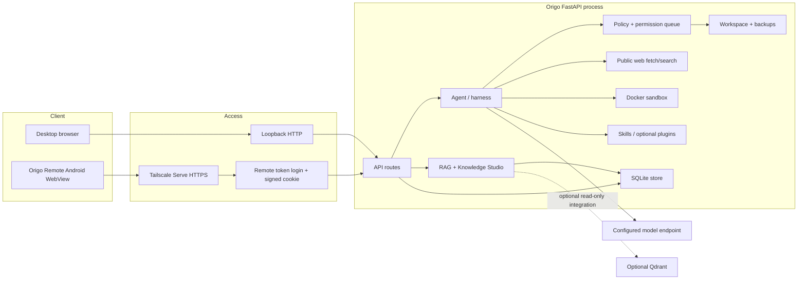
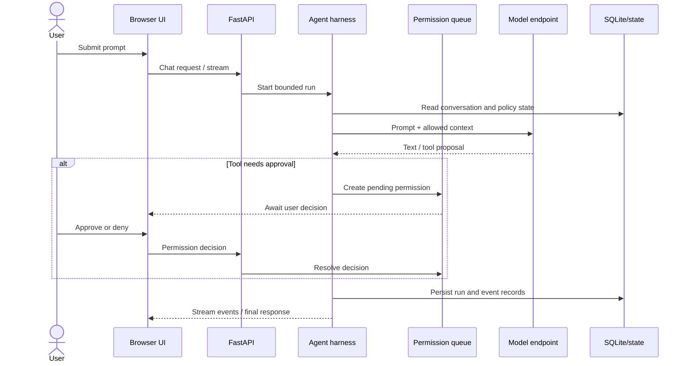
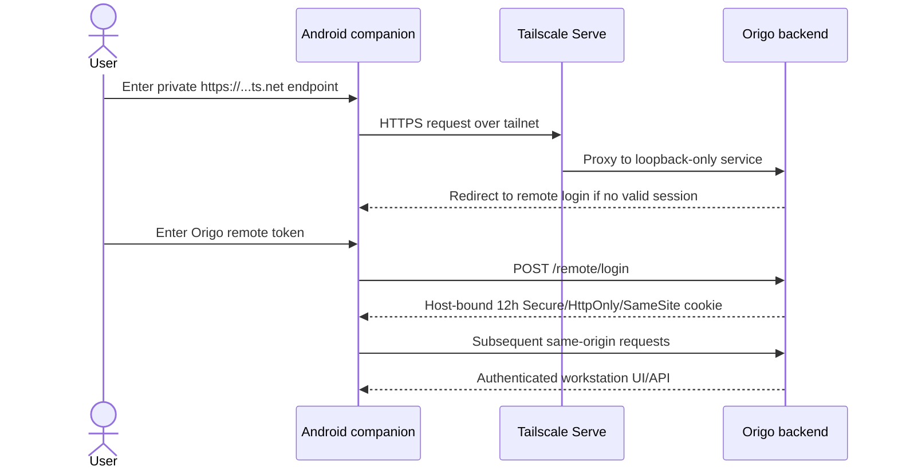
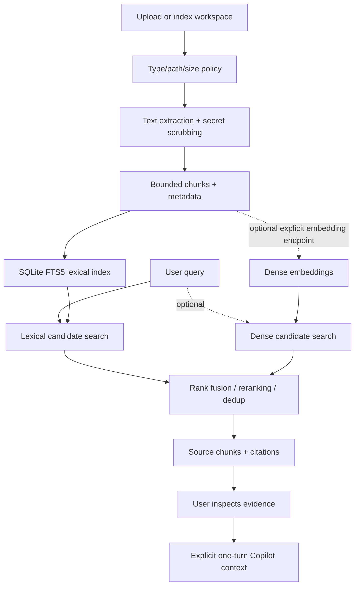

# Architecture and diagrams

This document describes the source layout and major interactions for the 1.7.2 baseline. The diagrams are Mermaid and render on GitHub.

## Component diagram

## Desktop chat sequence

## Remote Android connection

## RAG data flow

## Trust boundaries

1. Model responses and retrieved document content are untrusted input.
2. Browser requests are untrusted; remote requests must satisfy the remote access gate.
3. Workspace paths are constrained, but the process still runs as the current OS user.
4. External URLs are subject to validation, but DNS rebinding/SSRF residual risk remains.
5. Docker is a defense-in-depth boundary; Docker daemon, image, kernel and host configuration remain trusted.
6. Remote access is for one trusted user, not multi-user authorization.
