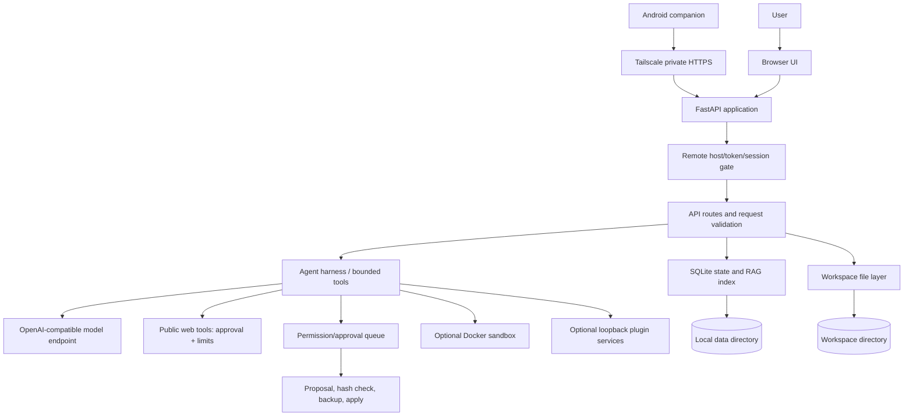

# System Design Document (SDD)

**Product:** Indra Origo  
**Release baseline:** 1.7.2  
**Status:** implementation-oriented design; see `STATUS.md` and the release audit for verified versus unverified behavior.

## 1. Purpose

Origo is a single-user, Windows-first, local-first AI workstation. It provides a model-agnostic chat/agent surface with bounded tools, explicit approval for sensitive actions, a persistent local state store, knowledge retrieval, and an optional private remote web client.

## 2. Goals and non-goals

### Goals
- Keep orchestration and permissions in the host harness rather than delegating all authority to a model.
- Keep default service binding local and make external effects explicit.
- Provide inspectable file-edit proposals, local run history and RAG evidence.
- Run selected commands in a constrained disposable Docker container when explicitly enabled.
- Permit optional access from the user's own phone over a private Tailscale network.

### Non-goals
- Multi-user tenancy, public hosted service, or public Internet exposure.
- General remote desktop/OS automation.
- A claim of superintelligence, verified correctness, semantic truth, or autonomous self-improvement.
- A guarantee of perfect isolation against a compromised host, Docker daemon, kernel, dependency, model endpoint or same-user process.

## 3. Context and actors

- **User:** initiates tasks, inspects evidence, approves or rejects proposals.
- **Web UI:** browser-based interface served by FastAPI.
- **Agent harness:** profiles, tool routing, limits, traces, run lifecycle and delegation policy.
- **Configured model endpoint:** local OpenAI-compatible gateway by default; may be hosted if explicitly configured.
- **Workspace and state store:** local files, SQLite state, backups and RAG index.
- **Optional services:** llama-swap, llama.cpp, Qdrant, Docker, local plugin services, Tailscale Serve.
- **Android companion:** WebView client to the user's private HTTPS endpoint; inference remains on the PC/provider.

## 4. Architectural overview

## 5. Main components

| Component | Responsibility | Trust boundary |
|---|---|---|
| `app/main.py` | FastAPI routes, lifecycle, remote gate and request orchestration | HTTP is untrusted input; remote mode has extra token/session checks |
| `app/agent.py`, `app/harness.py` | Tool orchestration, budgets, task/run control | Model output is untrusted and cannot independently grant permissions |
| `app/tools.py`, `app/web_tools.py` | Read/search/edit proposal and web tool wrappers | Inputs bounded; network targets still carry SSRF residual risk |
| `app/permissions.py` | Pending permission decisions | Sensitive effects require explicit user action |
| `app/sandbox.py` | Optional Docker runner | Docker daemon/image/kernel remain trusted components |
| `app/store.py` | Local persistent state, conversations and run data | Local filesystem permissions protect data; same-user isolation is not provided |
| `app/rag.py`, `app/knowledge.py` | Ingestion, chunks, lexical retrieval, optional embeddings and evidence | Documents are untrusted; external embeddings transmit text to configured endpoint |
| `app/static/*` | HTML/CSS/JS client and UI state | Browser is assumed to be local/approved origin; do not expose to arbitrary clients |
| `android/OrigoRemote` | HTTPS-only WebView wrapper and endpoint preference | Does not store remote token; uses browser-based Origo login |
| `scripts/*`, PowerShell/BAT | Setup, diagnostics, validation and launch | Host scripts are trusted local code and must be reviewed before execution |

## 6. Request and state lifecycle

1. UI submits an HTTP request to the local FastAPI service.
2. Middleware checks host/remote mode and validates the remote session when the request uses a Tailscale hostname.
3. Route validates request shape/size and checks the current policy or permission state.
4. The harness builds bounded context and calls the configured model endpoint if required.
5. Tool proposals are validated and permission-gated; proposed file changes include target hashes and backups before application.
6. Events/run data are persisted locally. Streaming runs can be cancelled; budgets bound duration, steps and tool calls.
7. UI state uses request identifiers/epochs to avoid stale asynchronous responses replacing newer state.

## 7. Data design and storage

- Project `.env`: local configuration and secrets; ignored by Git.
- `workspace/`: files the user explicitly chooses to work with.
- `data/`: SQLite databases, conversation/run state and RAG index; ignored by Git.
- `data/backups/`: backups of approved edits; ignored by Git.
- `logs/`: local diagnostics; ignored by Git.
- `skills/`: Markdown workflows; treated as instructions, not executable plugin code.
- `plugins/`: declarative plugin manifests and examples; disabled by default.

The exact SQLite schema can evolve; inspect `app/store.py` and `app/rag.py` for implementation. Do not copy live databases into a public issue or commit.

## 8. RAG design

1. Ingest supported files with size/type/path filters and secret scrubbing.
2. Split text into bounded chunks and persist document/chunk metadata in SQLite/FTS5.
3. Query lexical index; optionally query a configured embedding endpoint for dense candidates.
4. Fuse rankings, rerank and suppress duplicate/adjacent passages as implemented.
5. Return source metadata and stable citation labels; user inspects evidence before attaching it to Copilot.
6. Treat source text as untrusted prompt content. PDF parsing is disabled by default until upstream parser advisories are resolved.

## 9. Security design principles

- Loopback binding by default; remote use only through Tailscale Serve.
- Separate remote token and short-lived host-bound signed session cookie.
- Fail-closed remote configuration and explicit opt-in.
- Approval-gated file changes and network operations.
- Docker command execution disabled by default and networking disabled by default.
- Local HTTP plugins disabled by default.
- PDF parser disabled by default due to unresolved upstream advisories.
- No secrets, user data, SQLite databases or build credentials in source control.

## 10. Availability and failure behavior

The UI can load while the model, Docker, Qdrant or other optional services are unavailable. Diagnostics must be used to distinguish UI health from inference health. Failed model calls should surface errors instead of implying completion. Remote access cannot work if the PC is asleep/offline, Origo/Tailscale is stopped, the session expires, or the private network is unavailable.

## 11. Performance and resource limits

Agent step/tool/time/context caps and bounded file/RAG inputs are configuration-controlled. Parallel child agents should remain at one or two on constrained local inference servers. Docker sandbox resource caps are applied by the harness, but do not replace OS-level enforcement. Benchmarks must be run on the target machine; no universal latency/quality guarantee is made.

## 12. Verification and change control

See [Testing and release](TESTING_AND_RELEASE.md), `STATUS.md`, and [Security audit](SECURITY_AUDIT_1.7.2.md). Every change affecting tools, remote auth, file writes, parsing, network policy or state persistence should include tests and a threat-model note. Never claim a security certification based only on unit tests or pattern scans.
