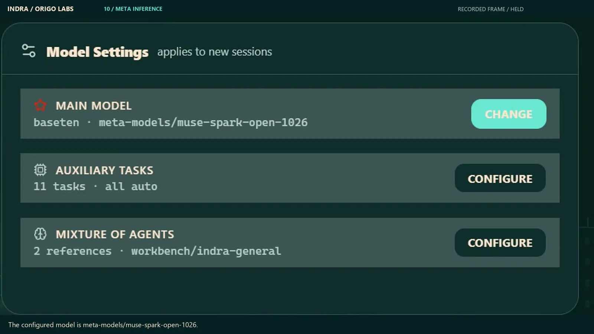
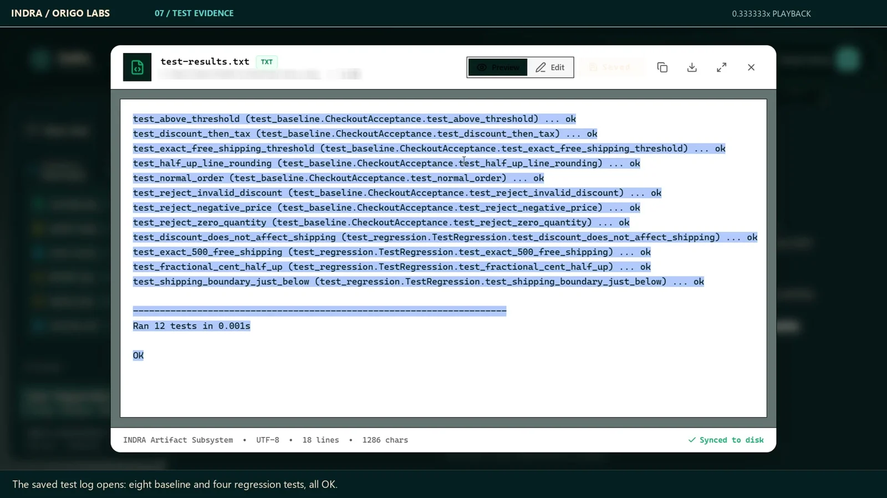
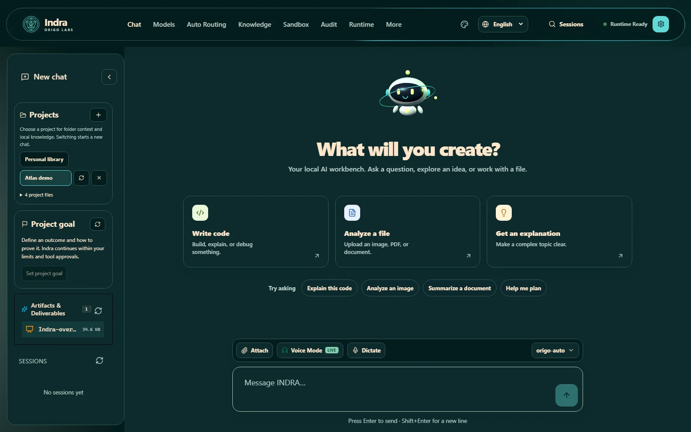
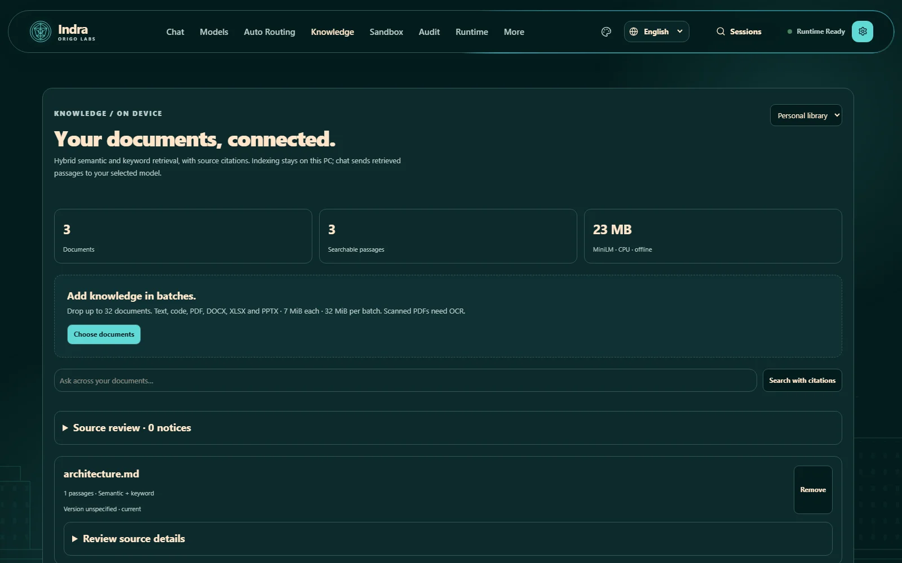
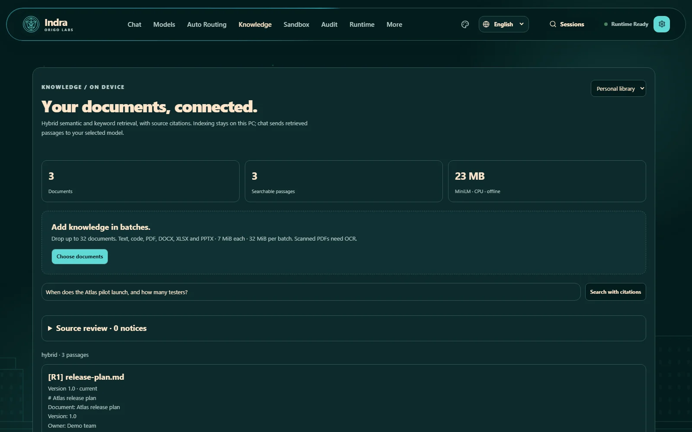
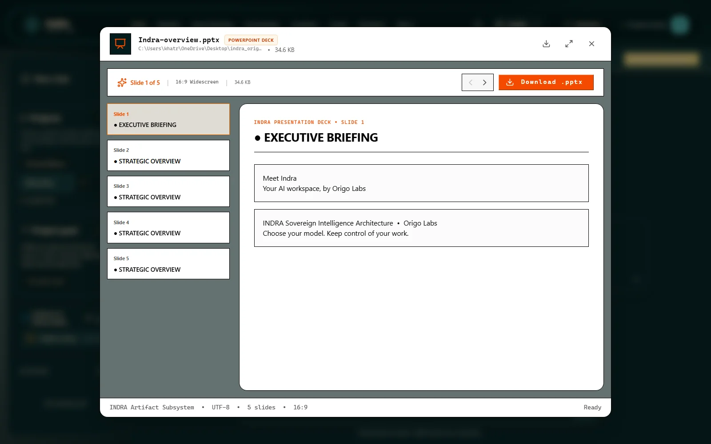
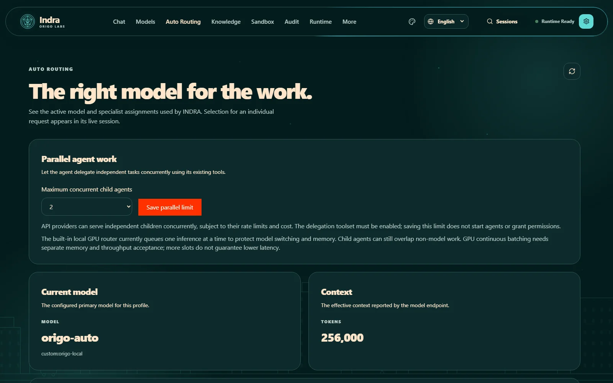
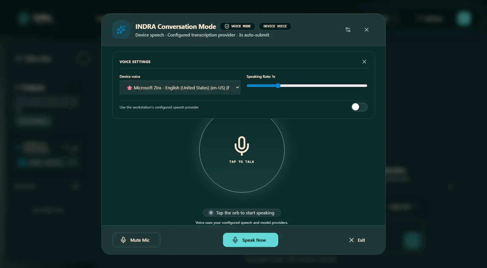
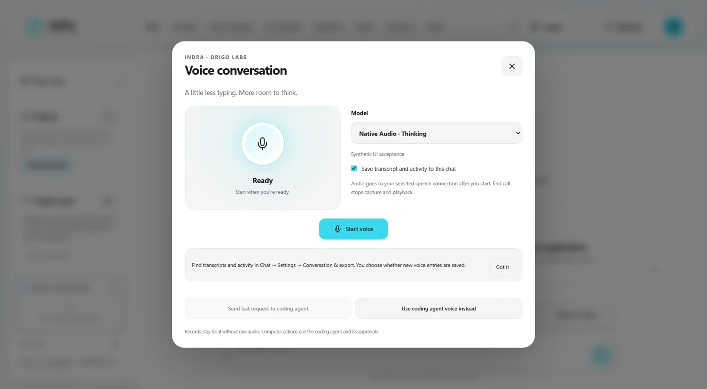
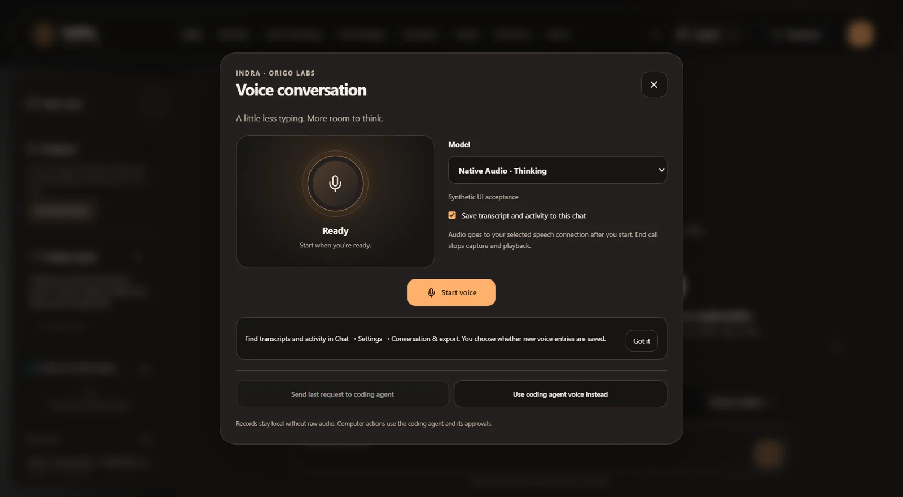

# Evidence and features beyond three minutes

The main [three-minute real-footage demo](https://github.com/Artyfowl1710/indra_Origo-Labs/releases/download/v1.8.0-rc.1/Indra-real-footage-3min.mp4) is the same film prepared for the submission and X. It uses a separate synthetic English narrator, original music, captions and actual video clips throughout. It opens on the running animated product front page and includes the supplied Docker walkthrough. Cuts remove waiting; speed changes are labelled. No held screenshot scenes or simulated model responses are used. The phone task is separate, usage is a local estimate, and the recorded Docker terminal mode mounts the selected project.

## Real recording evidence

The selected model is Baseten / meta-models/muse-spark-open-1026. Settings alone do not prove every call; inspect the task output and audit in the recording as well.

The actual task output reports 12 passing tests. [Completed source and generated files](../../examples/recorded-run/README.md) are published separately from the failing starter, enabling independent replay.

## Workbench gallery

The following screenshots were captured from an isolated running workbench with demo data. They illustrate implemented UI, not additional live provider-call claims. Fixture metrics are not benchmark results.

## Voice and appearance

[Watch eight seconds of the real voice interface](../media/voice-interface-real.mp4). This silent clip shows the actual recorded voice UI, not a claim of native Meta audio inference or unlimited voice access.

<video controls preload="metadata" src="../media/voice-interface-real.mp4" aria-label="Real recorded voice interface"></video>

These isolated UI captures show the voice controls across teal, light and ember themes. They do not establish unlimited speech access or successful live audio inference for every provider.

## What is deliberately excluded

Raw recordings include private settings and unrelated dialogs, so they are not public assets. Personal chat databases, bot handles/session material, API keys, signing keys and full runtime outputs are excluded. The public output sample is a reviewed fictional task. See [limits](limitations.md) before repeating demo claims.
